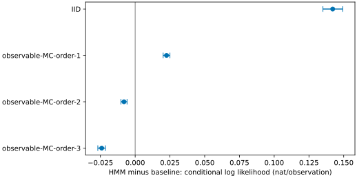
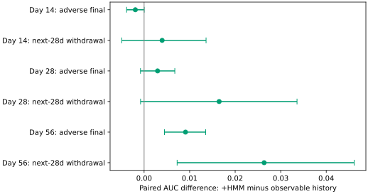
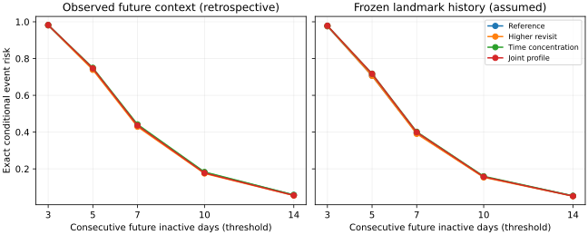

# 补充实验报告

本轮补充于2026-11-16至17日执行。原稿与原始结果未被覆盖；本轮使用公开KU/OULAD清洗面板。当前仓库是复现、补充基线与诊断，不是新的未触碰测试集。

## 1. 最重要的研究结论修正

1. HMM相对一阶MC有预测增益，但二阶、三阶可观测MC更强。结果支持“平台序列具有超出一阶可观测链的记忆”，不支持“HMM最优”或“隐状态是真实认知状态”。保留所有阶数，不能只报告有利比较。
2. Q2第28日的两项AUC提升，其配对95%区间均跨0；不能把点估计提升说成已证实的稳定提升。部分Brier/AP对比的区间不跨0，但属于多项探索比较，未做多重检验校正，也未覆盖模型选择不确定性。
3. KU匿名编号不能跨课程、学年关联同一人。撤回按裸编号聚类的中间诊断；不把数字碰撞当作真实学生重叠。主结果以注册记录为可恢复单位，未知跨课程相关性是限制。
4. Q3原回退参考过外层比较；回顾性未来行为路径也不是实时可用信息。冻结历史设定是敏感性，不会把观察模型变成因果干预模型。
5. 通过关联分数在2021存在明显校准漂移。高分不等于可靠通过概率；策略优化必须限于假设模型中的条件情景与权衡，不能给出有效干预的承诺。

## 2. Q1：固定模型重放与更强基线

固定原HMM参数，与原1399条2021序列的条件似然逐条核对，最大绝对误差约1.42e-14；一阶MC参数最大误差为0.00e+00。各模型均使用相同观测编码、42日历史前缀和后续评价窗口；新增可观测链仅用1819+1920训练，Dirichlet平滑0.5。区间为5000次注册级配对重采样，条件于已拟合参数。

| baseline | hmm_minus_baseline_nat_per_observation | ci_low | ci_high |
|---|---|---|---|
| IID | 0.142073 | 0.135053 | 0.149268 |
| observable-MC-order-1 | 0.022559 | 0.020116 | 0.025006 |
| observable-MC-order-2 | -0.008042 | -0.010232 | -0.005846 |
| observable-MC-order-3 | -0.024069 | -0.026859 | -0.021402 |

正数有利于HMM，负数有利于该可观测基线。新增阶数是事后稳健性诊断，不能宣称在全新保留集上完成了预注册选模。

## 3. Q2：OULAD配对增量与地标敏感性

使用旧内层选模记录确定的K=5、最终随机种子436572576，重放最终训练；没有重新挑选种子，训练似然与旧值相同。原始全网格、七个留模块外折的汇总表保留为旧实验来源，不宣称本轮全部重跑。重新生成14/28/56日地标下、两项结局的逐人预测，文件仅保留在本地`private/`。按学生进行2000次配对cluster bootstrap，比较AUC、AP和Brier。所有12组下游模型的AUC与旧表最大差为7.53e-06，Brier最大差为4.39e-15。28/56日的AUC与旧表相同；14日存在微小排名指标差异，不能宣称全部逐位相同。该差异可能与浮点排序或并列预测分数有关，但没有旧逐人预测供逐对核实；保留差异，不调参追齐。

第28日主分析：

| target | metric | hmm_minus_observable | ci_low | ci_high |
|---|---|---|---|---|
| adverse_final | AUC | 0.002961 | -0.000792 | 0.006746 |
| adverse_final | average_precision | 0.003796 | 0.000049 | 0.007547 |
| adverse_final | Brier | -0.001021 | -0.001834 | -0.000194 |
| withdrawal_next_28d_at_lm28 | AUC | 0.016479 | -0.000775 | 0.033584 |
| withdrawal_next_28d_at_lm28 | average_precision | 0.000448 | -0.012540 | 0.011820 |
| withdrawal_next_28d_at_lm28 | Brier | -0.000082 | -0.000153 | -0.000011 |

AUC/AP差为正较好，Brier差为负较好。固定拟合模型的测试集重采样并不包含重训练、状态数选择、超参数搜索的不确定性。完整三地标结果均在`q2_paired_differences.csv`。

## 4. Q3/Q4：数学公式、仿真及精度

重拟合旧NHMC；旧种子生成的前30000条共同随机数路径，12个情景—指标均值与旧表最大差为0.00e+00。随后每情景、每协变量设定扩大至100000路径，共4情景×2设定=800000条路径；共同随机数用于配对比较。

风险事件是未来28日内出现完全位于该窗口内的连续m个Platform-Inactive日，历史连续零计数重置为0。对m=3、5、7、10、14、两种设定、四情景，共40组同核同起点的DP—MC比较。全部误差在5倍条件MC标准误以内，最大标准化误差1.961；这是数值一致性诊断，不是教育效度检验。比较采用实际抽到的起点条件DP，避免把起点混合抽样误差误认为递推错误。

m=7的结果：

| context | scenario_id | risk_dp_equal_anchor | risk_mc | conditional_mcse |
|---|---|---|---|---|
| observed_future_context | reference_observed_profile | 0.435145 | 0.434890 | 0.001393 |
| observed_future_context | upper_revisit_profile | 0.429292 | 0.428710 | 0.001394 |
| observed_future_context | upper_time_concentration_profile | 0.442003 | 0.441720 | 0.001402 |
| observed_future_context | joint_supported_upper_profile | 0.436104 | 0.435290 | 0.001403 |
| frozen_landmark_history | reference_observed_profile | 0.393316 | 0.393720 | 0.001369 |
| frozen_landmark_history | upper_revisit_profile | 0.390609 | 0.390730 | 0.001372 |
| frozen_landmark_history | upper_time_concentration_profile | 0.401727 | 0.401870 | 0.001382 |
| frozen_landmark_history | joint_supported_upper_profile | 0.398996 | 0.398900 | 0.001385 |

配对误差使用D=指标(情景)-指标(参照)，MCSE=sd(D)/sqrt(N)。它只衡量数值积分误差，不是参数区间或因果效应区间。完整结果在`q34_paired_mcse.csv`。

## 5. 稳健性与多目标权衡

epsilon_completion与epsilon_risk各取0、0.001、0.002、0.005、0.01、0.02，交叉形成36个阈值组合；两种协变量设定均运行。每个点直接与全部原始候选比较，不用可能受非传递关系影响的顺序剪枝。用2000次注册级重采样估计前沿稳定性，固定核与校准模型。

epsilon两项均为0.005时：

| context | scenario_id | point_nondominated | registration_cluster_nondominated_frequency |
|---|---|---|---|
| observed_future_context | reference_observed_profile | False | 0.000000 |
| observed_future_context | upper_revisit_profile | True | 1.000000 |
| observed_future_context | upper_time_concentration_profile | False | 0.000000 |
| observed_future_context | joint_supported_upper_profile | False | 0.000000 |
| frozen_landmark_history | reference_observed_profile | True | 1.000000 |
| frozen_landmark_history | upper_revisit_profile | True | 1.000000 |
| frozen_landmark_history | upper_time_concentration_profile | False | 0.000000 |
| frozen_landmark_history | joint_supported_upper_profile | False | 0.000000 |

另外，对每个情景、每个设定，把转移核分别向均匀核与全Platform-Inactive核混合0.5%、2%、5%，共48项压力测试；路径事件的逐起点概率差均未超过耦合TV上界，违规数为0。这些人为扰动不是拟合参数置信域，也不是可识别的学生策略效应。

## 6. 校准和依然缺失的证据

| partition | pass_rate | mean_predicted_probability | expected_calibration_error_10_bins |
|---|---|---|---|
| calibration_1920 | 0.717893 | 0.717868 | 0.022957 |
| untouched_outer_2021 | 0.635454 | 0.780483 | 0.145029 |

旧标签`untouched_outer_2021`只表示旧校准脚本的分区名；本轮复查不是全新的未触碰验证。没有重调该校准模型来改善外层数值。

尚不能由现有公开日志补出的证据：校内锁定测试集、认知状态外部标签、策略随机干预、真实跨课程学生链接、HSMM显式时长拟合。七折外部验证本轮仅保留旧聚合记录。投稿前应按这些边界修改摘要、结论和局限性；不能用更多仿真替代缺失的实证。

## 7. 对论文写作的直接建议

将主线表述为“平台行为轨迹的记忆结构、隐状态模型的预测边界，以及假设条件下的风险—分数权衡”。数学部分证明递推正确性和扰动稳定性；实证部分允许可观测模型胜出。将二阶、三阶MC放入正式基线表，弱化HMM方法优越性；将Q3/Q4称为条件情景评估而非已验证策略优化。不要使用深度思考、偷懒等没有外部标签支持的状态命名。
